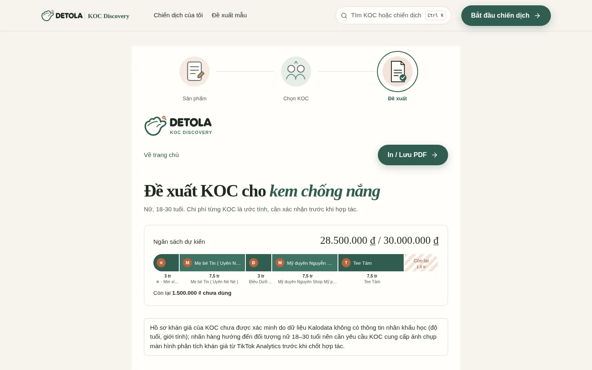
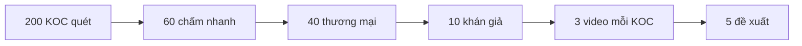

<p align="center">
  
</p>

<h1 align="center">DETOLA KOC Discovery</h1>

<p align="center"><em>From one product brief to five on-brand TikTok creators, within budget.</em></p>

<p align="center">
  
  
  
  
</p>

Nhập sản phẩm và ngân sách. KOC Discovery quét creator TikTok Việt Nam, chấm điểm và đề xuất nhóm KOC hợp thương hiệu, kèm lý do trỏ tới video.

| Bản đề xuất | Hồ sơ KOC | Điện thoại |
|---|---|---|
|  |  |  |

## Cách hoạt động

Phễu lọc rẻ trước, đắt sau: 200 KOC còn 5.



Điểm = 45% thương mại + 20% khán giả + 35% nội dung. KOC chỉ được chọn khi có video hợp thương hiệu từ 3/5 trở lên.

## Bắt đầu nhanh

Cần Python 3.12+, `ffmpeg`, Chromium và Node 20+.

```bash
python3 -m venv .venv && .venv/bin/pip install -e .
read -rs KALODATA_API_KEY && export KALODATA_API_KEY
read -rs OPENROUTER_API_KEY && export OPENROUTER_API_KEY
.venv/bin/koc run --dry-run        # ước tính chi phí, không gọi mạng
cd web && npm ci && npm run build && cd ..
.venv/bin/python -m koc.web        # http://127.0.0.1:8765
```

Khóa chỉ đặt qua biến môi trường, không ghi vào file. Lệnh và tham số đầy đủ: [Hướng dẫn chi tiết](docs/GUIDE.md).

## Kết quả

Kem chống nắng, ngân sách 30.000.000 đ:

| # | KOC | Điểm |
|---|---|---|
| 1 | @meixiuriviu | 79,0 |
| 2 | @rio100806 | 77,7 |
| 3 | @dieuduong_quynhhoa | 76,2 |
| 4 | @emduyencantho | 74,7 |
| 5 | @teetamofficial | 74,1 |

- Tổng phí 28.500.000 đ. Chạy lại tốn 6,5 credit và 0,28 USD.
- Cả dự án: 44,4 / 60 credit Kalodata, 1,62 / 5 USD mô hình.
- Lý do khớp bằng chứng: 0,875. Lưu ý: 0,10, đang cải thiện.
- 556 bài kiểm thử đạt. Mỗi mục được người duyệt độc lập chấm ĐẠT.

Xem thêm: [slide giới thiệu](docs/pitch/index.html) và [nhìn lại dự án](docs/RETROSPECTIVE.md).

## Bảo mật

- Web chỉ chạy trên máy, không có đăng nhập. Không mở ra mạng ngoài.
- Dữ liệu bên thứ ba (tiêu đề, lời nói) được bọc làm dữ liệu. Văn bản giống mệnh lệnh bị gắn "Cảnh báo bảo mật".
- Thứ hạng tính bằng số liệu, không theo lời mô hình. Mô hình vẫn có thể bị lừa: cảnh báo giúp kiểm tra tay.
- Thông tin liên hệ của creator bị xóa trước khi lưu.

## Giấy phép

MIT. Xem [LICENSE](LICENSE).
