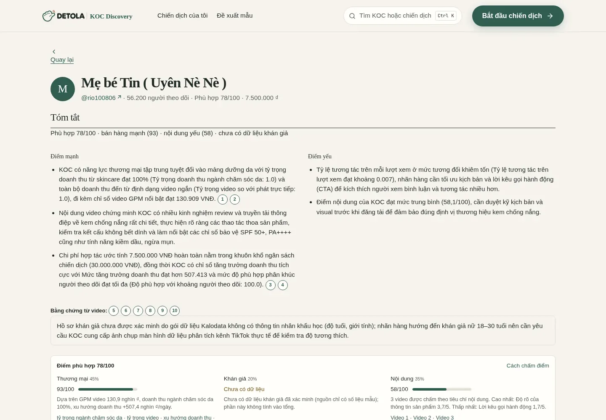
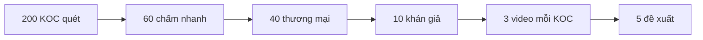
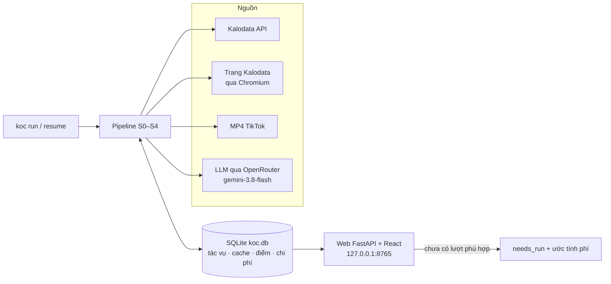

<p align="center">
  
</p>

<h1 align="center">DETOLA KOC Discovery</h1>

<p align="center"><em>From one product brief to five on-brand TikTok creators, within budget.</em></p>

<p align="center">
  
  
  
  
</p>

Nhập sản phẩm và ngân sách. KOC Discovery quét creator TikTok Việt Nam, chấm điểm và đề xuất nhóm KOC hợp thương hiệu, kèm lý do trỏ tới video.

| Bản đề xuất | Hồ sơ KOC | Điện thoại |
|---|---|---|
|  |  |  |

## Cách hoạt động

Phễu lọc rẻ trước, đắt sau: 200 KOC còn 5.



Điểm = 45% thương mại + 20% khán giả + 35% nội dung. Khi dữ liệu khán giả chỉ là số mẫu (gói Kalodata hiện tại), phần khán giả bị bỏ và điểm = (45 × thương mại + 35 × nội dung) / 80. KOC chỉ được chọn khi có video hợp thương hiệu từ 3/5 trở lên.

## Kiến trúc

Một máy, một file SQLite, hai giao diện: CLI chạy lượt trả phí, web đọc kết quả đã chấm.



| Giai đoạn | Làm gì | Nguồn | Còn lại |
|---|---|---|---|
| S0 | Quét creator theo ngành, VN, 10–300 nghìn follower | `creator/rank` (0,1 credit / 100 dòng) | 200 |
| S1 | Chấm thương mại: GPM video, xu hướng doanh thu, tỷ trọng video so với live, dải follower, tỷ trọng ngành (proxy) | `creator/detail`, `video/rank` | 60 → 40 |
| S2 | Đọc tỷ lệ nữ và độ tuổi khán giả | trang creator qua Chromium (0 credit) | 10 |
| S3 | Tải 3 video hợp chủ đề sản phẩm, 8 khung hình + âm thanh 90 giây đầu, chấm 7 tiêu chí kèm bằng chứng | `video/url` (0,5 credit), LLM | 10 |
| S4 | Cổng hợp thương hiệu, chọn tổ hợp điểm cao nhất trong ngân sách, viết lý do có trích dẫn | code + LLM | 5 |

Mỗi bước là một dòng trong bảng `tasks`; kết quả và trạng thái ghi cùng một transaction, nên `koc resume` chạy tiếp đúng chỗ dừng. Trần 60 credit và 5 USD được kiểm tra trong code trước mỗi request. Chi tiết: [kiến trúc](docs/ARCHITECTURE.md).

## Quyết định chính

| Quyết định | Vì sao |
|---|---|
| Phễu rẻ trước, đắt sau | Phân tích video tốn nhất; chỉ 10 KOC tới S3. Một lượt đầy đủ ≈ 26 credit, 0,43 USD. |
| SQLite + bảng tác vụ, không dùng hàng đợi | Chạy một máy, hay bị ngắt vì giới hạn tốc độ; resume không mất tiền đã tiêu. |
| Cache theo SHA-256, kèm phiên bản prompt | Chạy lại tốn 0. Đổi prompt thì không dùng lại kết quả cũ. Dữ liệu Kalodata hết hạn sau 7 ngày. |
| Cổng hợp thương hiệu là điều kiện cứng | Lượt đầu xếp hạng 4 một KOC quảng cáo dầu gội. Trọng số không đủ chặn; cổng thì có. |
| Chọn video hợp sản phẩm trước khi phân tích | Không trả tiền chấm video lạc đề. |
| Lý do phải trích mã bằng chứng có thật | Schema chỉ cho phép mã của chính KOC đó; mô hình chấm thứ hai đo độ trung thực. |
| Thứ hạng tính bằng code từ điểm số | Lời mô hình không quyết định ai được chọn. |
| Thiếu ngân sách thì từ chối, đưa 3 lựa chọn | Không tự giảm số KOC hay vượt ngân sách người dùng đặt. |
| Web không tự chạy lượt trả phí | Lượt chạy tốn tiền và cần đăng nhập Kalodata; web trả ước tính, người vận hành chạy từ CLI. |
| OpenRouter thay Google AI Studio | Không thanh toán được AI Studio; cùng model qua OpenRouter. |

## Bắt đầu nhanh

Cần Python 3.12+, `ffmpeg`, Chromium và Node 20+.

```bash
python3 -m venv .venv && .venv/bin/pip install -e .
read -rs KALODATA_API_KEY && export KALODATA_API_KEY
read -rs OPENROUTER_API_KEY && export OPENROUTER_API_KEY
.venv/bin/koc run --dry-run        # ước tính chi phí, không gọi mạng
cd web && npm ci && npm run build && cd ..
.venv/bin/python -m koc.web        # http://127.0.0.1:8765
```

Khóa chỉ đặt qua biến môi trường, không ghi vào file. Lệnh và tham số đầy đủ: [Hướng dẫn chi tiết](docs/GUIDE.md).

## Kết quả

Kem chống nắng, ngân sách 30.000.000 đ:

| # | KOC | Điểm |
|---|---|---|
| 1 | @meixiuriviu | 79,0 |
| 2 | @rio100806 | 77,7 |
| 3 | @dieuduong_quynhhoa | 76,2 |
| 4 | @emduyencantho | 74,7 |
| 5 | @teetamofficial | 74,1 |

- Tổng phí 28.500.000 đ. Chạy lại tốn 6,5 credit và 0,28 USD.
- Cả dự án: 44,4 / 60 credit Kalodata, 1,62 / 5 USD mô hình.
- Lý do khớp bằng chứng: 0,875. Lưu ý: 0,10, đang cải thiện.
- 556 bài kiểm thử đạt. Mỗi mục được người duyệt độc lập chấm ĐẠT.

Xem thêm: [slide giới thiệu](docs/pitch/index.html) và [nhìn lại dự án](docs/RETROSPECTIVE.md).

## Bảo mật

- Web chỉ chạy trên máy, không có đăng nhập. Không mở ra mạng ngoài.
- Dữ liệu bên thứ ba (tiêu đề, lời nói) được bọc làm dữ liệu. Văn bản giống mệnh lệnh bị gắn "Cảnh báo bảo mật".
- Thứ hạng tính bằng số liệu, không theo lời mô hình. Mô hình vẫn có thể bị lừa: cảnh báo giúp kiểm tra tay.
- Thông tin liên hệ của creator bị xóa trước khi lưu.

## Giới hạn

Hệ thống chứng minh được quy trình và chi phí; độ đúng của lựa chọn KOC thì chưa được người chấm xác nhận.

| Giới hạn | Tác động | Hệ thống đang xử lý thế nào |
|---|---|---|
| Không có dữ liệu khán giả thật (gói Kalodata chỉ trả số mẫu) | Không biết KOC có đúng nữ 18–30 | Nhận ra số mẫu, bỏ phần khán giả khỏi điểm, mọi đề xuất kèm lưu ý "chưa xác minh" |
| Giá booking là ước tính theo bậc follower | Tổng phí có thể lệch giá thật | Gắn nhãn ước tính; cần xác nhận với KOC hoặc MCN |
| Tỷ trọng doanh thu skincare dùng tổng doanh thu | 25 điểm thương mại gần như ai cũng tối đa | Ghi rõ là proxy; không làm đổi thứ tự top 5 |
| Dải tuổi 25–34 tính nguyên khi brief là 18–30 | Điểm khán giả có thể cao hơn thực tế | Chưa tác động vì phần khán giả đang bị bỏ |
| Web chỉ khớp với các lượt đã chạy | Sản phẩm mới không có kết quả ngay | Trả `needs_run` kèm ước tính credit, USD, phút |
| Chỉ 3 video mỗi KOC, rubric do mô hình chấm | Có thể không đại diện cả kênh | Cổng hợp thương hiệu; lý do khớp bằng chứng 0,875, lưu ý 0,10 |
| Web không có đăng nhập | Không an toàn nếu mở ra mạng | Mặc định 127.0.0.1, cảnh báo khi đổi host |

Đang làm: chấm tay 15 video của top 5 để so với điểm của mô hình.

## Giấy phép

MIT. Xem [LICENSE](LICENSE).
