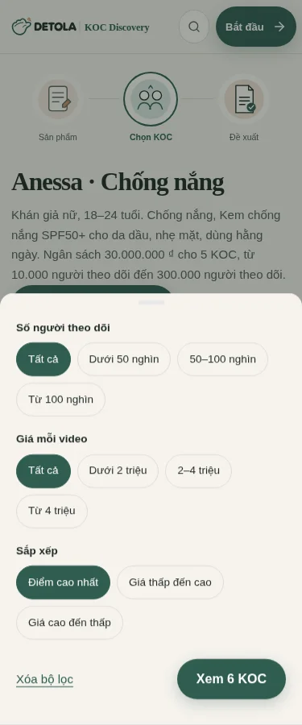
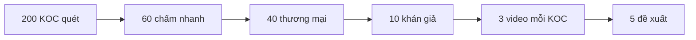
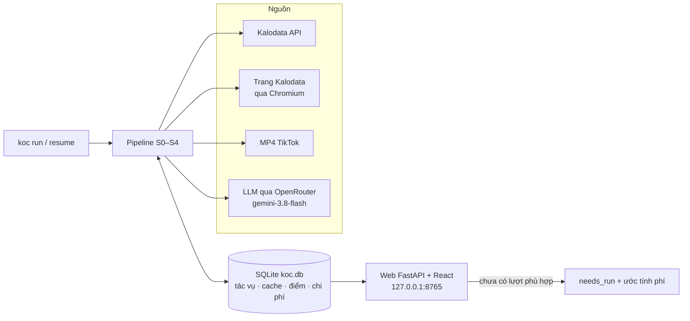

<p align="center">
  
</p>

<h1 align="center">DETOLA KOC Discovery</h1>

<p align="center"><em>From one product brief to five on-brand TikTok creators, within budget.</em></p>

<p align="center">
  
  
  
  
</p>

Nhập sản phẩm và ngân sách. KOC Discovery quét creator TikTok Việt Nam, chấm điểm và đề xuất nhóm KOC hợp thương hiệu, kèm lý do trỏ tới video.

## Bàn giao

| Yêu cầu | Ở đâu |
|---|---|
| Mã nguồn | Repo này, xem [Cấu trúc repo](#cấu-trúc-repo) |
| Prototype chạy được | [Bắt đầu nhanh](#bắt-đầu-nhanh), [slide có ảnh từng bước](docs/pitch/index.html) |
| Kiến trúc và quyết định | [Kiến trúc](#kiến-trúc), [Quyết định chính](#quyết-định-chính), [chi tiết](docs/ARCHITECTURE.md) |
| Kết quả 5 KOC, bằng chứng, chi phí, thời gian | [Kết quả](docs/RESULTS.md), [Benchmark lượt đầy đủ](docs/BENCHMARK.md) |
| Đo chất lượng, golden dataset | [Đánh giá chất lượng](#đánh-giá-chất-lượng) |
| Hướng dẫn, giới hạn, hướng mở rộng | [Bắt đầu nhanh](#bắt-đầu-nhanh), [Giới hạn](#giới-hạn), [Hướng mở rộng](#hướng-mở-rộng) |

| Bản đề xuất | Hồ sơ KOC | Điện thoại |
|---|---|---|
|  |  |  |

## Cách hoạt động

Phễu lọc rẻ trước, đắt sau: 200 KOC còn 5.



Điểm = 45% thương mại + 20% khán giả + 35% nội dung. Khi dữ liệu khán giả chỉ là số mẫu (gói Kalodata hiện tại), phần khán giả bị bỏ và điểm = (45 × thương mại + 35 × nội dung) / 80. KOC chỉ được chọn khi có video hợp thương hiệu từ 3/5 trở lên.

## Kiến trúc

Một máy, một file SQLite, hai giao diện: CLI chạy lượt trả phí, web đọc kết quả đã chấm.



| Giai đoạn | Làm gì | Nguồn | Còn lại |
|---|---|---|---|
| S0 | Quét creator theo ngành, VN, 10–300 nghìn follower | `creator/rank` (0,1 credit / 100 dòng) | 200 |
| S1 | Chấm thương mại: GPM video, xu hướng doanh thu, tỷ trọng video so với live, dải follower, tỷ trọng ngành (proxy, không tính điểm) | `creator/detail`, `video/rank` | 60 → 40 |
| S2 | Đọc tỷ lệ nữ và độ tuổi khán giả | trang creator qua Chromium (0 credit) | 10 |
| S3 | Tải 3 video hợp chủ đề sản phẩm, 8 khung hình + âm thanh 90 giây đầu, chấm 7 tiêu chí kèm bằng chứng | `video/url` (0,5 credit), LLM | 10 |
| S4 | Cổng hợp thương hiệu, chọn tổ hợp điểm cao nhất trong ngân sách, viết lý do có trích dẫn | code + LLM | 5 |

Mỗi bước là một dòng trong bảng `tasks`; kết quả và trạng thái ghi cùng một transaction, nên `koc resume` chạy tiếp đúng chỗ dừng. Trần 60 credit và 5 USD được kiểm tra trong code trước mỗi request. Chi tiết: [kiến trúc](docs/ARCHITECTURE.md).

## Quyết định chính

| Quyết định | Vì sao |
|---|---|
| Phễu rẻ trước, đắt sau | Phân tích video tốn nhất; chỉ 10 KOC tới S3. Một lượt đầy đủ ≈ 26 credit, 0,43 USD. |
| SQLite + bảng tác vụ, không dùng hàng đợi | Chạy một máy, hay bị ngắt vì giới hạn tốc độ; resume không mất tiền đã tiêu. |
| Cache theo SHA-256, kèm phiên bản prompt | Chạy lại tốn 0. Đổi prompt thì không dùng lại kết quả cũ. Dữ liệu Kalodata hết hạn sau 7 ngày. |
| Cổng hợp thương hiệu là điều kiện cứng | Lượt đầu xếp hạng 4 một KOC quảng cáo dầu gội. Trọng số không đủ chặn; cổng thì có. |
| Chọn video hợp sản phẩm trước khi phân tích | Không trả tiền chấm video lạc đề. |
| Lý do phải trích mã bằng chứng có thật | Schema chỉ cho phép mã của chính KOC đó; mô hình chấm thứ hai đo độ trung thực. |
| Thứ hạng tính bằng code từ điểm số | Lời mô hình không quyết định ai được chọn. |
| Thiếu ngân sách thì từ chối, đưa 3 lựa chọn | Không tự giảm số KOC hay vượt ngân sách người dùng đặt. |
| Web không tự chạy lượt trả phí | Lượt chạy tốn tiền và cần đăng nhập Kalodata; web trả ước tính, người vận hành chạy từ CLI. |
| OpenRouter thay Google AI Studio | Không thanh toán được AI Studio; cùng model qua OpenRouter. |

## Bắt đầu nhanh

Cần Python 3.12+, `ffmpeg`, Chromium và Node 20+.

```bash
python3 -m venv .venv && .venv/bin/pip install -e .
read -rs KALODATA_API_KEY && export KALODATA_API_KEY
read -rs OPENROUTER_API_KEY && export OPENROUTER_API_KEY
.venv/bin/koc run --dry-run        # ước tính chi phí, không gọi mạng
cd web && npm ci && npm run build && cd ..
.venv/bin/python -m koc.web        # http://127.0.0.1:8765
```

Khóa chỉ đặt qua biến môi trường, không ghi vào file. Lệnh và tham số đầy đủ: [Hướng dẫn chi tiết](docs/GUIDE.md).

## Cấu trúc repo

```
src/koc/            pipeline S0–S4, cache, trần chi phí, CLI (koc run / resume / report / faithfulness)
src/koc/llm/        gọi mô hình, prompt có schema, kiểm bằng chứng, chống chèn lệnh
src/koc/web/        API FastAPI cho web
web/                giao diện React
config/             trọng số, giới hạn phễu, bảng giá, từ khóa sản phẩm
prompts/            prompt có phiên bản (content_v3, reasons_v4, faithfulness_v1)
tests/              560 bài kiểm thử, chạy offline
scripts/            benchmark, xuất kết quả, phiếu chấm và chỉ số đánh giá
docs/               kiến trúc, benchmark, kết quả, giới hạn, đánh giá (eval/), slide (pitch/)
docs/research/      khảo sát Kalodata và tính khả thi ban đầu
docs/process/       kế hoạch, bằng chứng và kết quả review từng hạng mục (lịch sử xây dựng)
design/             logo, hình minh họa, hệ thống thiết kế
reports/            benchmark.json (đơn vị chi phí dùng để ước tính)
```

## Kết quả

Kem chống nắng, ngân sách 30.000.000 đ:

| # | KOC | Điểm |
|---|---|---|
| 1 | @meixiuriviu | 79,0 |
| 2 | @rio100806 | 77,7 |
| 3 | @dieuduong_quynhhoa | 76,2 |
| 4 | @emduyencantho | 74,7 |
| 5 | @teetamofficial | 74,1 |

- Tổng phí 28.500.000 đ. Chạy lại tốn 6,5 credit và 0,28 USD.
- Cả dự án: 44,4 / 60 credit Kalodata, 1,62 / 5 USD mô hình.
- Lý do khớp bằng chứng: 0,875. Lưu ý: 0,10, đang cải thiện.
- 560 bài kiểm thử đạt. Mỗi mục được người duyệt độc lập chấm ĐẠT.

Từng KOC với lý do, trích dẫn video có mốc thời gian và chi phí theo giai đoạn: [docs/RESULTS.md](docs/RESULTS.md). Lượt chạy đầy đủ 200 ứng viên: 2.598 giây, 26,0 credit và 0,43 USD trên đường thành công; 27,6 credit và 1,32 USD tính cả lần thử lỗi ([BENCHMARK](docs/BENCHMARK.md)).

Giới hạn và cách hệ thống tự bảo vệ: [docs/LIMITATIONS.md](docs/LIMITATIONS.md). Bảng trên tính theo trọng số S1 cũ; với trọng số mới điểm giảm 1,3 đến 2,4 và tập top 40 S1 không đổi (thứ tự bên trong có đổi) và thứ tự top 5 giữ nguyên.

Xem thêm: [slide giới thiệu](docs/pitch/index.html) và [nhìn lại dự án](docs/RETROSPECTIVE.md).

## Đánh giá chất lượng

Hệ thống có nhiều "agent" nối tiếp (lọc thương mại, phân tích video, chọn nhóm, viết lý do). Mỗi agent được đo riêng so với nhãn của người, không chỉ đo kết quả cuối.

### Kết quả vòng chấm đầu (lượt `0e555cac`, 1 người chấm, chấm mù)

| Agent | Chỉ số | Kết quả | Mục tiêu |
|---|---|---|---|
| Phân tích video (S3) | Đồng thuận hợp thương hiệu, cùng phía ngưỡng 3/5 | 23/28 video (82%) | ≥ 80% |
| Phân tích video (S3) | Lệch ≤ 1 điểm so với người | 22/28 (79%) | ≥ 80% |
| Phân tích video (S3) | Trích dẫn đúng khi người mở video đúng giây | 26/29 đúng, 3 đúng một phần, 0 sai (95%) | ≥ 95% |
| Chọn nhóm (S4) | Precision@5: KOC người chấm cũng chọn | 1/5 chấm mù (2/5 sau khi người chấm đổi 1 KOC) | ≥ 4/5 |
| Chọn nhóm (S4) | nDCG@5 so với cả 10 KOC đã phân tích | 0,59 chấm mù (0,77 sau khi đổi) | ≥ 0,85 |
| Chọn nhóm (S4) | KOC tốt bị bỏ sót | 2/5 | 0 |
| Chọn nhóm (S4) | Vi phạm yêu cầu cứng (ngân sách, số KOC, cổng) | 0 | 0 |
| Viết lý do (S4) | Lý do khớp bằng chứng được trích (mô hình thứ hai chấm) | 0,875 | ≥ 0,85 |

Đọc kết quả: AI đọc video đúng (không trích dẫn bịa, 82% đồng thuận với người), nhưng chọn KOC lệch vì người chấm chọn theo độ tuổi và phong cách hợp Gen Z, điều hệ thống chưa đo (không có dữ liệu khán giả, rubric không có tiêu chí này). Hướng sửa: thêm tiêu chí `audience_persona_fit` vào rubric video. Người chấm là người xây hệ thống, mẫu nhỏ: đọc như tín hiệu, không phải kết luận thống kê. Chi tiết: [docs/eval/METRICS.md](docs/eval/METRICS.md).

### Cách dựng golden dataset

1. **Chọn brief.** Ít nhất 3 loại sản phẩm (ví dụ kem chống nắng, son, serum), mỗi loại một khán giả. Tách 2 nhóm: brief để chỉnh hệ thống và brief giữ kín chỉ dùng để đo, không bao giờ dùng để sửa prompt hay trọng số.
2. **Chọn ứng viên cần gán nhãn.** Tất cả KOC tới bước phân tích video (đo độ chính xác và bỏ sót), cộng một mẫu ngẫu nhiên 10–20 KOC bị loại ở bước thương mại (đo bỏ sót ở phễu sớm).
3. **Viết tiêu chí trước khi chấm** và không sửa sau ([ví dụ](docs/eval/0_criteria.md)). Mọi tiêu chí người dùng để chọn KOC phải nằm ở đây, kể cả tiêu chí khó đo như độ tuổi, phong cách.
4. **Chấm mù, 3 tầng**, bằng phiếu sinh tự động (`scripts/eval_sheets.py`), thứ tự xáo trộn, không hiện điểm hay lựa chọn của hệ thống:
   - video: hợp thương hiệu 1–5;
   - KOC: có / có điều kiện / không, và hạng 0–3;
   - bằng chứng: mỗi câu trích dẫn đúng / một phần / sai, mở video đúng giây.
5. **Hai người chấm** ít nhất 20% mẫu, báo độ lệch giữa hai người. Nếu hai người lệch nhiều hơn người và AI, nhãn chưa đủ tin để đo.
6. **Lưu nhãn cùng `run_id`, ngày và phiên bản tiêu chí** trong `docs/eval/`. Nhãn của brief cũ không sửa; tiêu chí mới thì gán nhãn lại.

### Cách đo agent có làm đúng không

| Agent | So với nhãn nào | Chỉ số |
|---|---|---|
| Lọc thương mại (S0–S1) | KOC phù hợp trong mẫu bị loại sớm | Recall: tỷ lệ KOC tốt còn sống qua từng bước |
| Phân tích video (S3) | Điểm video của người | Đồng thuận cùng phía ngưỡng, lệch ≤ 1, sai lệch trung bình |
| Phân tích video (S3) | Kiểm bằng chứng | Câu trích có thật, đúng giây, đúng nghĩa |
| Chọn nhóm (S4) | Kết luận và hạng KOC | Precision@5, nDCG@5 trong nhóm và so với cả nhóm ứng viên, bỏ sót, vi phạm yêu cầu cứng |
| Viết lý do (S4) | Bằng chứng được trích | Mô hình chấm thứ hai (`koc faithfulness`), đối chiếu với người trên một mẫu để biết mô hình chấm có tin được không |
| Cả hệ thống | `api_calls`, `llm_calls` | Credit, USD, token, thời gian mỗi giai đoạn ([BENCHMARK](docs/BENCHMARK.md)) |

```bash
PYTHONPATH=src .venv/bin/python scripts/eval_sheets.py --run <run_id>    # sinh phiếu chấm mù
PYTHONPATH=src .venv/bin/python scripts/eval_metrics.py --run <run_id>   # tính chỉ số từ phiếu đã chấm
```

Khi đổi prompt, trọng số hay cổng: chạy lại các brief đã gán nhãn, tính lại chỉ số trên cùng nhãn, và chỉ giữ thay đổi nếu không chỉ số nào tụt. Đổi prompt làm mất cache LLM nên lượt đo lại tốn phí phân tích video; đổi trọng số hay cổng thì đo lại bằng `--cache-only`, 0 đồng.

## Bảo mật

- Web chỉ chạy trên máy, không có đăng nhập. Không mở ra mạng ngoài.
- Dữ liệu bên thứ ba (tiêu đề, lời nói) được bọc làm dữ liệu. Văn bản giống mệnh lệnh bị gắn "Cảnh báo bảo mật".
- Thứ hạng tính bằng số liệu, không theo lời mô hình. Mô hình vẫn có thể bị lừa: cảnh báo giúp kiểm tra tay.
- Thông tin liên hệ của creator bị xóa trước khi lưu.

## Giới hạn

Hệ thống chứng minh được quy trình và chi phí; độ đúng của lựa chọn KOC thì chưa được người chấm xác nhận.

| Giới hạn | Tác động | Hệ thống đang xử lý thế nào |
|---|---|---|
| Không có dữ liệu khán giả thật (gói Kalodata chỉ trả số mẫu) | Không biết KOC có đúng nữ 18–30 | Nhận ra số mẫu, bỏ phần khán giả khỏi điểm, mọi đề xuất kèm lưu ý "chưa xác minh" |
| Giá booking là ước tính theo bậc follower | Tổng phí có thể lệch giá thật | Gắn nhãn ước tính; cần xác nhận với KOC hoặc MCN |
| Tỷ trọng doanh thu skincare dùng tổng doanh thu | 25 điểm thương mại gần như ai cũng tối đa, không phân biệt được KOC | Trọng số về 0 từ v2.0 (proxy, không tính điểm); lượt cũ giữ điểm cũ và có ghi chú; thứ tự top 5 không đổi |
| Dải tuổi 25–34 tính nguyên khi brief là 18–30 | Điểm khán giả có thể cao hơn thực tế | Chưa tác động vì phần khán giả đang bị bỏ |
| Web chỉ khớp với các lượt đã chạy | Sản phẩm mới không có kết quả ngay | Trả `needs_run` kèm ước tính credit, USD, phút |
| Chỉ 3 video mỗi KOC, rubric do mô hình chấm | Có thể không đại diện cả kênh | Cổng hợp thương hiệu; lý do khớp bằng chứng 0,875, lưu ý 0,10 |
| Một lượt đầy đủ mất 43 phút, chạy tuần tự | Không dùng được như ô tìm kiếm tức thì; 61% thời gian là phân tích 30 video lần lượt | Là việc nghiên cứu theo lô: web trả kết quả ngay từ lượt đã lưu, chạy lại từ cache mất vài giây, 0 đồng |
| Web không có đăng nhập | Không an toàn nếu mở ra mạng | Mặc định 127.0.0.1, cảnh báo khi đổi host |

Đang làm: chấm tay mù 30 video của 10 KOC đã phân tích (5 được chọn, 5 bị loại) để đo Precision@5, độ đúng bằng chứng và KOC bị bỏ sót ([cách chấm](docs/eval/HOW_TO_JUDGE.md)).

## Hướng mở rộng

| Hướng | Cách làm | Ghi chú |
|---|---|---|
| 50–500 ứng viên | Tăng giới hạn S0–S2 trong `config/pipeline.yaml`. Chi phí dự báo: 27,3 credit (50), 29,4 (200), 29,7 (500), vì chỉ S0–S1a tăng theo N | S2 là nút thắt: tài khoản trial mở 10 trang/ngày, 15–20 giây mỗi creator |
| Chạy song song | S3 chiếm 1.581 / 2.598 giây và 30 video độc lập với nhau: chạy 5–10 worker trên cùng bảng `tasks`. Ước tính S3 còn 3–5 phút, cả lượt 12–15 phút (CHƯA ĐO) | S1b bị giới hạn tốc độ Kalodata (2 giây/request), S2 bị giới hạn tài khoản trial; trần credit/USD đã có khóa `BEGIN IMMEDIATE` |
| Dữ liệu khán giả thật | Gói Kalodata có nhân khẩu học, hoặc ảnh TikTok Analytics từ KOC | Bật lại 20% điểm khán giả |
| Giá booking thật | Bảng giá MCN hoặc chào giá của KOC thay `config/rate_card.yaml` | Tổ hợp trong ngân sách sẽ chính xác hơn |
| Doanh thu theo ngành | Gọi chi tiết creator không lọc ngành để có tổng, rồi chia | Thêm khoảng 0,1 credit mỗi KOC |
| Sản phẩm khác | Thêm từ khóa vào `config/video_topics.yaml` và mã ngành vào `config/product_categories.yaml` | Pipeline không cần sửa code |
| Chọn KOC đúng khán giả | Thêm tiêu chí `audience_persona_fit` (độ tuổi, phong cách, hợp Gen Z hay người lớn) vào rubric video; mô hình đã thấy khung hình và nghe giọng | Vòng chấm đầu: người chọn theo tiêu chí này, hệ thống bỏ lỡ (Precision@5 = 1/5). Chấm lại 30 video ≈ 0,25 USD |
| Golden dataset lớn hơn | 3 loại sản phẩm, 2 người chấm, brief giữ kín để đo | Buộc lưu ý trích dẫn bằng chứng (độ trung thực lưu ý 0,10) |
| Từ điển tiếng lóng tiếng Việt | Bảng từ lóng giới trẻ và cách nói của KOC ("mấy vợ", "bụp liền", "chốt đơn"...) đưa vào prompt phân tích video và lưu trong `config/` | Vòng kiểm bằng chứng: mô hình ghi "mấy vợ" thành "mấy bà"; ý vẫn đúng nhưng mất sắc thái hướng tới khán giả trẻ |
| Triển khai cho nhóm | Thêm đăng nhập và phân quyền trước khi mở web ra mạng | Hiện chỉ chạy trên máy |

## Giấy phép

MIT. Xem [LICENSE](LICENSE).
