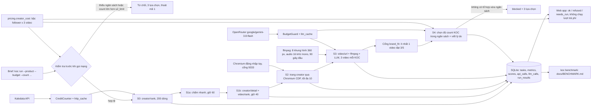

# Kiến trúc KOC Discovery

KOC Discovery thu hẹp danh sách creator TikTok qua năm giai đoạn, lưu dữ liệu, tác vụ, cache và chi phí trong một file SQLite, rồi chọn số KOC theo brief của lượt chạy (mặc định 5 KOC trong 30.000.000 VND) theo điểm và ngân sách. [src/koc/pipeline.py](../src/koc/pipeline.py) [src/koc/db.py](../src/koc/db.py)

Sơ đồ: brief từ CLI qua bước kiểm tra trước khi gọi mạng, rồi phễu S0 đến S4 đi từ dữ liệu rẻ tới dữ liệu đắt; cổng brand_fit đứng trước S4, mọi bước ghi vào SQLite qua bộ đếm chi phí và cache.

## Luồng dữ liệu

Trước S0, `koc run` dựng brief từ tham số (`--product`, `--product-type`, `--category-ids`, `--gender`, `--age-min`, `--age-max`, `--budget`, `--count`) và lưu vào `runs.params_json` khóa `brief`. `check_brief` chạy trước mọi lượt gọi mạng và từ chối khi `--count` lớn hơn `s2_limit` hoặc ngân sách nhỏ hơn `--count` nhân phí 3 video của bậc rẻ nhất. `koc resume` từ chối brief khác brief đã lưu. [src/koc/brief.py](../src/koc/brief.py) [src/koc/cli.py](../src/koc/cli.py) [config/product_categories.yaml](../config/product_categories.yaml)

S0 gọi `creator/rank` cho khu vực VN, kỳ 30 ngày, follower 10.000 đến 300.000, lọc theo category IDs của brief (mặc định `601602`, `873864` và `601627` trong `config/scoring.yaml`). Mặc định pipeline nhận tối đa 200 dòng. [src/koc/pipeline.py](../src/koc/pipeline.py) [src/koc/kalodata.py](../src/koc/kalodata.py) [config/scoring.yaml](../config/scoring.yaml)

S1a chấm nhanh từ dữ liệu rank và giữ 60 creator (`s1a_limit`). S1b gọi `creator/detail` và `video/rank` cho từng creator, tính điểm thương mại rồi giữ 40 (`s1_limit`). [src/koc/pipeline.py](../src/koc/pipeline.py) [config/pipeline.yaml](../config/pipeline.yaml)

S2 mở trang chi tiết creator trong Chromium qua CDP, đọc tỷ lệ follower nữ và hai nhóm tuổi 18-24, 25-34. S2 dừng khi đủ 10 creator (`s2_limit`), các tác vụ còn lại chuyển sang `skipped`. 10 creator có dữ liệu khán giả đi tiếp vào S3. [src/koc/pipeline.py](../src/koc/pipeline.py) [src/koc/stages.py](../src/koc/stages.py) [config/pipeline.yaml](../config/pipeline.yaml)

S3 lấy 3 video có doanh thu cao nhất của mỗi creator, ưu tiên video gắn với sản phẩm top 3. Pipeline tải MP4 qua `video/url`. `ffmpeg` chỉ xét 90 giây đầu (`max_analyzed_seconds`): 8 khung hình JPEG rộng 360 px trong khoảng đó và âm thanh mono 16 kHz, mp3 32 kbps, cắt bằng `-t`. Model trả rubric 7 tiêu chí, rủi ro và danh sách bằng chứng. Điểm S3 là trung bình 7 tiêu chí thang 0 đến 5, đổi sang 0 đến 100. [src/koc/pipeline.py](../src/koc/pipeline.py) [src/koc/llm/media.py](../src/koc/llm/media.py) [src/koc/llm/content.py](../src/koc/llm/content.py) [config/llm_prices.yaml](../config/llm_prices.yaml)

S4 bỏ các creator không qua cổng brand_fit, tính điểm cuối, duyệt mọi tổ hợp `count` creator, giữ tổ hợp có tổng điểm cao nhất mà tổng phí ước tính không quá ngân sách của brief và không trùng MCN khi biết mã MCN. Không có tổ hợp nào vừa thì lượt chạy dừng ở `blocked` với ba lựa chọn. Khi chọn được, LLM viết 3 đến 5 lý do cho mỗi KOC, và phần ngân sách dư được ghi vào `runs.params_json` khóa `s4`. [src/koc/stages.py](../src/koc/stages.py) [src/koc/pipeline.py](../src/koc/pipeline.py) [src/koc/llm/reasons.py](../src/koc/llm/reasons.py)

## Mô hình chấm điểm

S1 dùng trọng số trong `config/scoring.yaml`: GPM video 46,67, xu hướng doanh thu 20, tỷ trọng doanh thu video so với live 20, độ phù hợp dải follower 13,33. `skincare_revenue_share` có trọng số 0: code truyền tổng `detail.revenue`, nên chỉ số này là proxy (không phải doanh thu riêng skincare), được lưu và hiển thị với nhãn "proxy, không tính điểm". Trước đây trọng số là 35/25/15/15/10; xem [docs/LIMITATIONS.md](LIMITATIONS.md). Tương tác trên lượt xem chỉ dùng để phân hạng khi điểm S1 bằng nhau. [config/scoring.yaml](../config/scoring.yaml) [src/koc/stages.py](../src/koc/stages.py) [src/koc/pipeline.py](../src/koc/pipeline.py)

S2 = 50% tỷ lệ follower nữ + 50% tổng tỷ lệ tuổi 18-24 và 25-34. S3 chấm hook, độ rõ sản phẩm, trình diễn, chất lượng claim, CTA, độ phù hợp thương hiệu và chất lượng sản xuất. [src/koc/stages.py](../src/koc/stages.py) [src/koc/llm/content.py](../src/koc/llm/content.py)

Điểm cuối = (45 × S1 + 20 × S2 + 35 × S3) / 100. Khi S2 của một creator là placeholder, S2 bị bỏ và hai trọng số còn lại được chuẩn hóa lại: (45 × S1 + 35 × S3) / 80. Phí mỗi KOC = đơn giá theo bậc follower × 3 video, tính bằng `creator_cost` trong `src/koc/pricing.py`. [src/koc/stages.py](../src/koc/stages.py) [config/scoring.yaml](../config/scoring.yaml) [config/rate_card.yaml](../config/rate_card.yaml) [src/koc/pricing.py](../src/koc/pricing.py)

Điều kiện vào S4: ít nhất một video đã phân tích của lượt chạy (theo `koc.db.run_analyses`) có điểm rubric `brand_fit` từ `s4.min_brand_fit` = 3 trở lên. Creator không có video đã phân tích thì không đủ điều kiện. Cùng hàm `brand_fit_gate` dùng cho S4, nhóm ứng viên của web, `koc status` và báo cáo. [src/koc/stages.py](../src/koc/stages.py) [config/scoring.yaml](../config/scoring.yaml)

## Kiểm soát chi phí

Kalodata có trần 60 credits (`credits_cap`), cộng dồn trên mọi lượt chạy trong cùng database. `CreditCounter.reserve` mở `BEGIN IMMEDIATE`, kiểm tra trần rồi ghi một dòng `pending` trước khi gửi request. Giá cấu hình: creator detail 0,1 credit, creator/video rank 0,1 mỗi 100 dòng, video URL 0,5. Lượt xem trang creator ở S2 có giá `ui_creator_detail_view: 0.0`. Giá này đã kiểm tra ngày 15/11/2026: sau 38 lượt xem, số dư tài khoản giảm 2,6 credits (145,2 xuống 142,6), đúng bằng phần tăng của bộ đếm API. Benchmark của lượt live cũng ghi 0 credit cho mọi lượt `ui/creator_detail`. [config/kalodata_prices.yaml](../config/kalodata_prices.yaml) [src/koc/kalodata.py](../src/koc/kalodata.py) [docs/BENCHMARK.md](BENCHMARK.md)

LLM có trần 5 USD (`usd_cap`), cộng dồn trên cả database. Trước mỗi lượt gọi, kể cả lượt sửa lỗi, `pricing.py` tính cận trên chi phí từ byte UTF-8 của prompt và schema, 200 token overhead, số tile ảnh và giây âm thanh. Hệ số an toàn 1,5 áp cho ảnh và âm thanh vì đơn giá đa phương thức của OpenRouter chưa được xác minh. `BudgetGuard.check` từ chối nếu chi phí đã dùng cộng cận trên vượt trần. Sau phản hồi, `BudgetGuard.record` ghi chi phí và dừng nếu chi phí thật vượt ước tính. Giá model: 0,825 USD mỗi 1 triệu token vào, 4,125 USD mỗi 1 triệu token ra. [config/llm_caps.yaml](../config/llm_caps.yaml) [config/llm_prices.yaml](../config/llm_prices.yaml) [src/koc/llm/pricing.py](../src/koc/llm/pricing.py) [src/koc/budget_guard.py](../src/koc/budget_guard.py)

## Chạy tiếp sau khi dừng

Mỗi tác vụ có một dòng trong bảng `tasks` với trạng thái lưu trong SQLite. `complete_task` ghi kết quả và chuyển tác vụ sang `done` trong cùng một transaction. Nếu tiến trình chết trước commit, cả kết quả và trạng thái cùng rollback. `koc resume` đặt tác vụ `failed`, `blocked` hoặc có lỗi `blocked:` về `pending` rồi chạy tiếp. [src/koc/db.py](../src/koc/db.py) [src/koc/pipeline.py](../src/koc/pipeline.py)

Cách xử lý lỗi theo loại:

- Kalodata `RATE_LIMIT` (mã 2017): client chờ 15, 60 rồi 180 giây, sau đó chặn mọi tác vụ còn lại của giai đoạn. Client giữ tối thiểu 2 giây giữa hai request. [src/koc/kalodata.py](../src/koc/kalodata.py)
- Kalodata mã 1054 (video đang được lấy): chờ 30, 60, 120 giây rồi chặn tác vụ. [src/koc/kalodata.py](../src/koc/kalodata.py)
- Phản hồi `success: false` khác là lỗi và không được cache. Riêng `video/rank` trả `not found` được ghi thành danh sách rỗng, 0 credit, và được cache. [src/koc/kalodata.py](../src/koc/kalodata.py)
- Lỗi tài khoản LLM (OpenRouter HTTP 401, 402, 403) ném `ProviderAccountError`. Pipeline dừng ngay, tác vụ quay về `pending` với lý do "tài khoản LLM (nạp tiền/khóa API)", lượt chạy kết thúc ở `blocked`. Không tác vụ nào bị đánh dấu thất bại vì hết tiền. [src/koc/llm/openrouter.py](../src/koc/llm/openrouter.py) [src/koc/pipeline.py](../src/koc/pipeline.py)
- Vượt trần chi phí: chặn tác vụ hiện tại và các tác vụ S3, S4 còn lại. [src/koc/pipeline.py](../src/koc/pipeline.py)
- Lỗi phân tích một creator ở S3 chỉ làm hỏng tác vụ đó; S4 vẫn chạy nếu đủ 5 điểm nội dung. Lỗi không lường trước làm lượt chạy `failed`. [src/koc/pipeline.py](../src/koc/pipeline.py)

Nếu Kalodata đã trả kết quả nhưng tiến trình chết trước khi ghi cache, resume sẽ gọi lại request đó. [src/koc/kalodata.py](../src/koc/kalodata.py)

## Quyết định chính

- **Phễu rẻ trước, đắt sau.** S0 và S1 dùng API rẻ (0,1 credit) để giảm 200 creator xuống 40. Chỉ 10 creator tới S3, nơi mỗi video tốn 0,5 credit và một lượt gọi LLM. Trong lượt live, S3 chiếm 14,50 trên 26,00 credits và 0,4065 trên 0,4336 USD của đường thành công. [config/pipeline.yaml](../config/pipeline.yaml) [docs/BENCHMARK.md](BENCHMARK.md)
- **Bảng tác vụ SQLite và resume.** Pipeline chạy trên một máy, gọi dịch vụ trả phí, và có thể bị ngắt bởi giới hạn tốc độ hoặc hạn mức trial. Một file SQLite với tác vụ hoàn tất trong cùng transaction với kết quả đủ cho resume mà không cần dịch vụ hàng đợi. [docs/process/build/CONTRACTS.md](process/build/CONTRACTS.md) [src/koc/db.py](../src/koc/db.py)
- **Cache theo SHA-256.** Khóa cache Kalodata là SHA-256 của endpoint và JSON request đã chuẩn hóa. Khóa cache LLM là SHA-256 của hash media, phiên bản prompt, tên model và brand brief. Đưa phiên bản prompt vào khóa để kết quả của prompt cũ không bị dùng lại sau khi đổi prompt. Cache hit tốn 0 credit và 0 token. [src/koc/db.py](../src/koc/db.py) [src/koc/budget_guard.py](../src/koc/budget_guard.py) [src/koc/pipeline.py](../src/koc/pipeline.py)
- **Trần credit và USD nằm trong code.** Kiểm tra trước mỗi request, không dựa vào cảnh báo của nhà cung cấp, vì một lỗi vòng lặp có thể tiêu hết số dư trước khi người vận hành thấy. [src/koc/kalodata.py](../src/koc/kalodata.py) [src/koc/budget_guard.py](../src/koc/budget_guard.py)
- **OpenRouter thay cho Google AI Studio.** Amendment A2 trong [docs/process/build/CONTRACTS.md](process/build/CONTRACTS.md) ghi lý do: không thanh toán được Google AI Studio, khóa LLM có sẵn là khóa OpenRouter. Model `google/gemini-3.8-flash`, khung hình gửi dạng `image_url`, âm thanh dạng `input_audio`, đầu ra theo `response_format` `json_schema` strict. A2 ghi "reasoning disabled", nhưng lần thử live ngày 15/11/2026 cho thấy model này không tắt được reasoning, nên config đặt `reasoning: {effort: minimal}`. Đường `gemini` qua `google-genai` vẫn chọn được. [config/llm_prices.yaml](../config/llm_prices.yaml) [src/koc/llm/openrouter.py](../src/koc/llm/openrouter.py) [src/koc/llm/factory.py](../src/koc/llm/factory.py)
- **Prompt `content_v3`, transcript dựng trong code.** Model không trả transcript riêng. Code ghép các trích dẫn `speech` trong danh sách bằng chứng theo thời gian và cắt ở 1.200 ký tự. Transcript vì vậy chỉ chứa câu có mã bằng chứng. Mỗi tiêu chí rubric phải trích ít nhất một mã bằng chứng có thật; phản hồi sai được sửa một lần bằng lượt `content_v3_repair`. [src/koc/llm/content.py](../src/koc/llm/content.py) [prompts/content_v3.md](../prompts/content_v3.md)
- **Phát hiện khán giả placeholder theo từng creator.** Gói Kalodata đang dùng hiển thị một bộ số mẫu (nữ 60%, 18-24 tuổi 30,5%, 25-34 tuổi 39,5%). Một creator bị coi là placeholder khi số của creator đó trùng bộ mẫu này, hoặc khi từ 3 creator trở lên trong lượt có cùng một bộ số. Với creator placeholder, S4 bỏ S2 và chuẩn hóa lại điểm cuối như ở mục chấm điểm. [src/koc/stages.py](../src/koc/stages.py) [src/koc/pipeline.py](../src/koc/pipeline.py)
- **Lý do đề xuất bị ràng buộc bằng chứng.** Schema JSON của `reasons_v4` đặt `cited_evidence_ids` là enum chỉ gồm mã metric và mã bằng chứng video của chính creator đó, nên model không tạo được mã không tồn tại. Khi khán giả chưa xác minh, code bắt buộc thêm lưu ý "chưa xác minh" và lọc câu nêu tỷ lệ giới tính, độ tuổi hay "khán giả khớp" bằng regex theo từng mệnh đề. Bộ lọc regex chỉ là lưới an toàn: nó không hiểu cách diễn đạt mà nó không có từ khóa. Kiểm soát chính là prompt và lưu ý bắt buộc. Lý do lấy từ cache cũng được kiểm tra lại với dữ liệu khán giả hiện tại. [src/koc/llm/reasons.py](../src/koc/llm/reasons.py) [src/koc/pipeline.py](../src/koc/pipeline.py)
- **Lỗi tài khoản nhà cung cấp dừng lượt chạy.** Khi hết tiền hoặc khóa sai, mọi lượt gọi tiếp theo đều sẽ lỗi. Dừng ngay và giữ tác vụ ở `pending` giúp nạp tiền rồi `koc resume` mà không mất creator nào. [src/koc/pipeline.py](../src/koc/pipeline.py)
- **Chế độ `--cache-only`.** Lượt chạy chỉ đọc cache; cache miss ném `CacheOnlyMiss` và chặn tác vụ thay vì gọi mạng. Chế độ này dùng để chạy lại lượt đã xong với chi phí 0 và kiểm tra tiêu chí C6. Trình duyệt S2 không được mở trong chế độ này. [src/koc/cli.py](../src/koc/cli.py) [src/koc/pipeline.py](../src/koc/pipeline.py)
- **Benchmark tách đường thành công và tổng thực chi.** Lượt gọi LLM thuộc đường thành công khi nó tạo ra kết quả được giữ lại, ghi trong bảng `run_results`. Lượt chạy cũ không có bảng này thì phần thành công được ước tính theo `request_hash`, phiên bản prompt và model, và giai đoạn đó mang cờ `success_estimated`. Tổng thực chi luôn gồm lần thất bại, lượt sửa lỗi và kết quả bị thay thế, để không ẩn chi phí. [src/koc/benchmark.py](../src/koc/benchmark.py) [docs/BENCHMARK.md](BENCHMARK.md)
- **Cổng brand_fit trước S4 (D-B7).** Đọc lại top 5 của lượt live cho kem chống nắng thấy KOC hạng 4 (`@rio100806`) có video quảng cáo dầu gội trị gàu cho nam, `brand_fit` 2, 0, 2, và KOC hạng 2 (`@ducvietbe__`) có video kem tay và phấn phủ, `brand_fit` 2, 0, 1. Điểm bán hàng S1 bão hòa nên không tách được các KOC này, còn điểm nội dung chỉ chiếm 35% điểm cuối. Cổng là điều kiện cứng thay vì thêm trọng số, vì một KOC không quảng bá sản phẩm cùng loại thì không nên được chọn dù điểm khác cao. Trên lượt live, cổng loại 4 trên 9 KOC có điểm nội dung, còn đúng 5 KOC. Chạy lại S4 tốn 2 lượt gọi LLM, 0,0109 USD. [src/koc/stages.py](../src/koc/stages.py) [config/scoring.yaml](../config/scoring.yaml) [docs/process/build/REVIEW_brand_fit_gate_r2.md](process/build/REVIEW_brand_fit_gate_r2.md)
- **Thiếu ngân sách thì từ chối, không tự giảm (D-B1, D-B2).** Kế hoạch chỉ 3 KOC khi người dùng xin 5, hoặc vượt ngân sách, đều là kết quả người dùng không yêu cầu. CLI, S4 và web vì vậy từ chối và đưa ba lựa chọn tính từ creator đã chấm: số KOC lớn nhất còn vừa, ngân sách tối thiểu cho số KOC đã xin, nhóm follower rẻ hơn. Phần ngân sách dư không được dùng để thêm KOC; nó được báo ra. [src/koc/brief.py](../src/koc/brief.py) [src/koc/pipeline.py](../src/koc/pipeline.py) [src/koc/web/matching.py](../src/koc/web/matching.py)
- **Một hàm giá cho mọi nơi.** Review web refusal vòng 1 tìm ra web tính phí một video, còn pipeline nhân 3: web duyệt 1 KOC với ngân sách 1.000.000 VND trong khi pipeline tính KOC đó 3.000.000 VND. `src/koc/pricing.py` nay là nguồn duy nhất: bậc follower × 3 video, follower ngoài bảng giá lấy bậc gần nhất, không bao giờ trả 0. [src/koc/pricing.py](../src/koc/pricing.py) [docs/process/build/REVIEW_web_refusal.md](process/build/REVIEW_web_refusal.md)
- **Web không chạy lượt trả phí (D-B4).** Khi chưa có lượt chạy đã chấm cho loại sản phẩm, web trả `needs_run` kèm lệnh `koc run --dry-run ...` dựng từ form. Lượt chạy tốn credit và USD, cần Chromium đăng nhập tay cho S2, nên người vận hành chạy nó từ CLI. [src/koc/web/matching_api.py](../src/koc/web/matching_api.py)
- **Một brief cho mỗi lượt chạy (D-B3).** Brief lưu trong `runs.params_json`, và `koc resume` từ chối brief khác, để kết quả của một lượt luôn ứng với đúng một sản phẩm và một ngân sách. [src/koc/brief.py](../src/koc/brief.py) [src/koc/cli.py](../src/koc/cli.py)
- **Phí booking là ước tính.** Không có nguồn giá booking thật, nên phí lấy theo bậc follower trong `config/rate_card.yaml` và có nhãn "UOC TINH (ESTIMATE)". Cần xác nhận với creator hoặc MCN trước khi đặt. [config/rate_card.yaml](../config/rate_card.yaml)

## Mở rộng 50 đến 500 ứng viên

[docs/BENCHMARK.md](BENCHMARK.md) mục 5 dự báo chi phí bằng đơn giá theo ứng viên đo từ lượt live nhân với số ứng viên ở mỗi giai đoạn. Vì các mức 60, 40 và 10 cố định, chỉ S0 và S1a tăng theo N. Tổng thực chi dự báo: 27,33 credits ở 50 ứng viên, 29,38 ở 200, 29,68 ở 500; USD giữ ở 1,4605. [docs/BENCHMARK.md](BENCHMARK.md) [src/koc/benchmark.py](../src/koc/benchmark.py)

Muốn đánh giá nhiều creator hơn thì phải nâng `s2_limit` và các mức trước nó. Khi đó S2 là nút thắt: tài khoản trial chỉ mở được 10 trang chi tiết mỗi ngày, và mỗi creator mất khoảng 15 đến 20 giây. Hạn mức của gói trả phí chưa được xác minh. [docs/research/FACTS.md](research/FACTS.md) [config/pipeline.yaml](../config/pipeline.yaml)

## Giới hạn đã biết

- Dữ liệu khán giả của cả 10 creator qua S2 trong lượt live là placeholder; điểm cuối của 5 KOC được chọn không có thành phần khán giả. [docs/BENCHMARK.md](BENCHMARK.md)
- S1 bão hòa: 53 trên 60 creator đạt 100 ở `video_gpm` và 53 trên 60 đạt 100 ở `skincare_revenue_share`, thành phần này nay có trọng số 0 (truy vấn chỉ đọc trên bản sao DB của lượt `7372009b22764b339fbcf0f3efb4bc4e`). [src/koc/stages.py](../src/koc/stages.py) [config/scoring.yaml](../config/scoring.yaml)
- Lượt live từng có điểm nội dung từ ba phiên bản prompt. Ngày 16/11/2026, 6 KOC được chấm lại bằng `content_v3` và S4 chạy lại với `reasons_v4`. Hàng phân tích cũ vẫn giữ trong `analyses` cho sổ chi phí; `koc.db.run_analyses` chọn đúng phân tích mà S3 của lượt chạy đã dùng (ưu tiên `run_results`, rồi `content_v3`, rồi hàng mới nhất), để S4 và giao diện không trích bằng chứng cũ. [docs/BENCHMARK.md](BENCHMARK.md)
- Cổng brand_fit chạy sau S3, tức sau khi đã trả tiền tải và phân tích video. S3 không chọn video theo sản phẩm của brief. [src/koc/pipeline.py](../src/koc/pipeline.py)
- `koc run --dry-run` in khoảng ước tính tín dụng, USD, token và phút (nhãn "ước tính") từ đơn vị mỗi creator trong `reports/benchmark.json`; dòng kế hoạch lấy giới hạn từ cấu hình (S2 còn `s2_limit` = 10). Trường `run_estimate` của `needs_run` dùng cùng hàm. Khoảng phút là ±25% quanh giá trị đo, chưa hiệu chỉnh. [src/koc/estimate.py](../src/koc/estimate.py) [src/koc/cli.py](../src/koc/cli.py)
- Cache Kalodata có hạn dùng `cache_ttl_days` = 7 (trong `config/pipeline.yaml`) cho `creator/rank`, `creator/detail` và `video/rank`: dòng cũ hơn 7 ngày bị gọi lại và ghi đè. Phân tích video, cache LLM và `video/url` không hết hạn. Chạy lại thường (không `--cache-only`) một lượt cũ hơn 7 ngày sẽ gọi lại Kalodata và tốn credit; `koc run --cache-only` bỏ qua hạn dùng và chạy lại với 0 credit, 0 token. Chạy lại cùng brief trong 7 ngày vẫn trả lại cùng các KOC đã đề xuất; loại KOC của lượt trước nằm trong kế hoạch v2.0. [src/koc/db.py](../src/koc/db.py) [src/koc/kalodata.py](../src/koc/kalodata.py)
- `video_count: 3` trong config chưa được code đọc; S3 cắt danh sách bằng hằng số `[:3]`. [config/pipeline.yaml](../config/pipeline.yaml) [src/koc/pipeline.py](../src/koc/pipeline.py)
- Chưa có ASR. Transcript tiếng Việt là trích dẫn do model trả về, chưa có benchmark độ chính xác. [src/koc/llm/content.py](../src/koc/llm/content.py)
- Spearman tính trên n = 9, chỉ để tham khảo. [docs/BENCHMARK.md](BENCHMARK.md)
- Điều khoản sử dụng cho việc đọc trang Kalodata, tải MP4 và dùng API chưa được xác minh. [docs/research/RISKS.md](research/RISKS.md)
